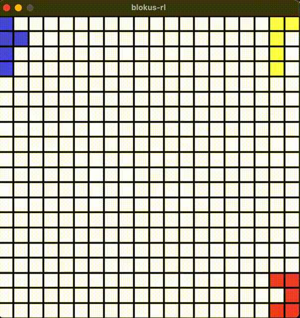

# blokus-rl
A [PettingZoo-API-compatible](https://pettingzoo.farama.org) reinforcement learning (RL) environment for the strategy board game [Blokus](https://en.wikipedia.org/wiki/Blokus).



## Installation

### pip
`pip install -U blokus-rl`
### Poetry
`poetry add blokus-rl`
### Source
```
git clone https://github.com/APirchner/blokus-rl.git
cd blokus-rl
pip install -U maturin
maturin build [--release]
pip install {path/to/wheel}.whl
```

## Example usage

```python
from blokus_rl import BlokusEnv

env = BlokusEnv(render_mode="human")
env.reset()
scores = {}
for agent in env.agent_iter():
    observation, reward, termination, truncation, info = env.last()
    if termination or truncation:
        # the agent is out of moves, its score is final and it leaves the game
        scores[agent] = reward
        action = None
    else:
        action = env.action_space(agent).sample(mask=observation["action_mask"])
    env.step(action)
print(scores)
```

Rewards are each agent's own Blokus score: minus the squares of its remaining pieces, +15 for placing all pieces, +20 if the monomino was placed last.
An agent gets its score as soon as it is out of moves, since it can never get moves back. Competitive objectives such as win/loss or rank can be computed from the scores at the end of the episode.

## Action space
Every action places one of the 91 piece orientations (21 pieces in all their distinct rotations and flips) on the 20x20 board.
Actions are laid out as a grid of shape `(orientation, row, col)` = `env.action_grid_shape` = `(91, 20, 20)` and flattened in C order into `Discrete(36400)`:
`(row, col)` is the top-left corner of the piece's bounding box, in the frame of the acting agent.
Positions where the piece would not fit on the board are always masked.

```python
action_mask = observation["action_mask"].reshape(env.action_grid_shape)
orientation, row, col = np.unravel_index(action, env.action_grid_shape)
```

## Motivation
I'm not a passionate gamer and get frustrated quite easily when a board game does not go my way. For some reason, I always enjoy playing Blokus - wheter I'm winning or not. And being a computer scientist by training, I was always wondering what weird/effective strategies a powerful RL agent would uncover.

While there are a few comprehensive RL libraries such as [RLlib](https://docs.ray.io/en/latest/rllib/index.html) and environments for common classical boardgames and Atari games, I was not able to find an environment for Blokus that implements with the typical APIs. This repo should fill this gap.

Working mostly in Python, I started out with a inefficient implementation and soon found that masking invalid moves did not scale well.
It never hurts to have some lower-level language in your toolbox, so I started from scratch in Rust - both as a Rust-learning experience and a way to speed up Blokus episodes.

## Implementation details
Internally, the game is implemented with [bitboards](https://www.chessprogramming.org/Bitboards). A set of 4 u128 integers represents the board of 20x20 tiles and an additional column of separating bits. All game logic is built on bit operations - from generating all possible actions to finding the valid subsets of actions for each player at each turn of the game.
While doing research on how to speed up the masking of invalid actions, I found the smart Blokus [implementation](https://github.com/nikohass/rust-socha2021) by [nicohass](https://github.com/nikohass). From this repo I picked up the idea of using bitboards. The basics on how to rotate boards come from the [Chess Programming Wiki](https://www.chessprogramming.org/Flipping_Mirroring_and_Rotating).

The internal logic of the game is implemented in Rust, while the API is exposed through a Python class. The Python bindings for the Rust code are built with [PyO3](https://pyo3.rs/) and [maturin](https://www.maturin.rs).
